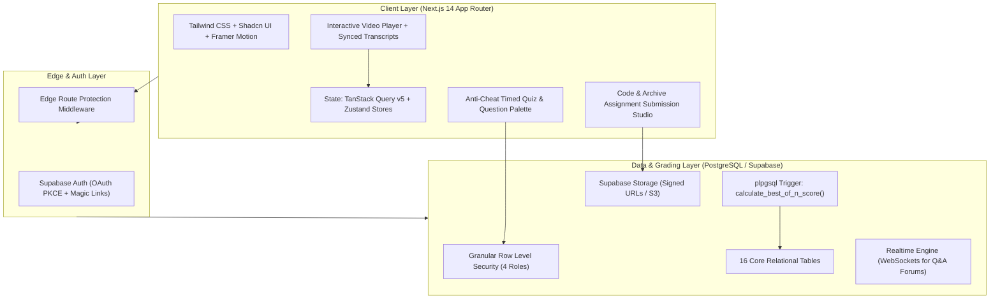
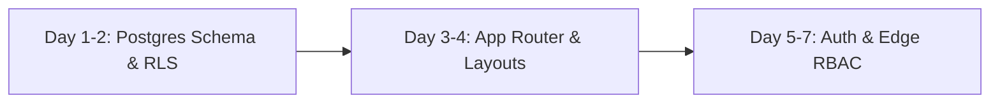
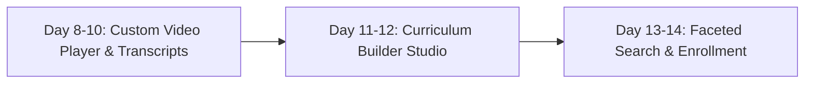
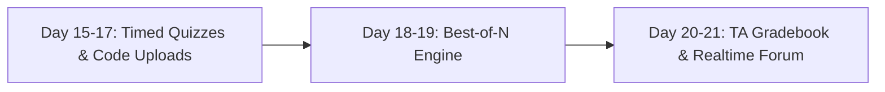
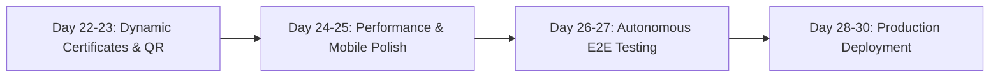

# Enterprise LMS: 30-Day Engineering & Development Roadmap
**Project:** AetherLMS — Next-Gen Academic Operating System  
**Architecture:** Next.js 14 (App Router) &bull; Supabase (PostgreSQL, Auth, RLS, Realtime, Storage) &bull; TanStack Query &bull; Zustand &bull; Mux / HLS  
**Author:** Principal Full-Stack Engineer &amp; System Architect  
**Status:** Approved for Implementation  

---

## 1. Executive Summary & Vision

Modern online higher education is divided into two contrasting paradigms:
1. **Coursera**: Exceptional video delivery, high aesthetic polish, modular course progression, and smooth self-paced navigation, but historically vulnerable to poor completion rates (~12%) due to the absence of rigid academic cadence and enforceable deadlines.
2. **NPTEL (National Programme on Technology Enhanced Learning)**: Exceptional academic discipline, weekly mandatory assignments with hard cutoffs, automated grading, proctored examinations, and university-accredited certifications, but historically hindered by legacy UI/UX, lack of real-time collaboration, and rigid, inflexible scoring pipelines.

**AetherLMS** synthesizes both paradigms into a unified, enterprise-grade academic platform that surpasses both. It provides modern HLS streaming, interactive search-enabled transcripts, and modular syllabus tracks, backed by **strict weekly deadlines**, an **automated Best-of-N scoring engine** (e.g. Best 8 of 12 assignments counted), **proctored exam slot allocation**, and **tamper-proof cryptographic certificates with public QR verification**.

---

## 2. 30-Day Master Milestone Calendar

| Week | Phase Focus | Primary Objectives | Key Deliverables |
| :---: | :--- | :--- | :--- |
| **Week 1** | **Foundation, DB &amp; Role Security** | 16-table PostgreSQL schema, full RLS matrix, Next.js 14 App Router layout shells, and RBAC middleware. | Migration script, auth flow, role-protected layouts. |
| **Week 2** | **Next-Gen Content Engine** | Custom HLS video player with auto-resume, synchronized search transcripts, instructor builder studio, and course catalog. | Interactive video player, transcript seek, drag-and-drop course studio. |
| **Week 3** | **Rigorous Evaluation &amp; Grading** | Timed anti-cheat quizzes, code &amp; file submissions with hard cutoffs, Best-of-N score engine, and TA grading queue. | Timed quiz engine, code upload portal, database Best-of-N trigger, gradebook. |
| **Week 4** | **Verification, QA &amp; Launch** | Dynamic PDF certificate generator, public verification page (`/verify/[id]`), end-to-end tests, performance tuning, and Vercel launch. | Verifiable QR certificates, Playwright test suite, production deployment. |

---

## 3. Detailed Day-by-Day Implementation Plan

### Week 1: Foundation, Database Architecture & Role Security
> **Goal:** Build an enterprise-grade database schema and lightning-fast authentication backbone with zero-trust role-based access control.

#### Day 1–2: Database & RLS Setup (Supabase / PostgreSQL)
- **Schema Engineering**:
  - Implement 16 relational tables with strict foreign keys and cascading rules: `profiles`, `courses`, `modules`, `lessons`, `enrollments`, `lesson_progress`, `assignments`, `assignment_submissions`, `quizzes`, `quiz_questions`, `quiz_attempts`, `certificates`, `proctored_exams`, `exam_registrations`, `forum_threads`, `forum_replies`, and `notifications`.
  - Define custom PostgreSQL Enums: `user_role` (`student`, `instructor`, `evaluator`, `admin`), `course_status`, `lesson_type`, `submission_status`, `certificate_status`.
- **Row-Level Security (RLS) Implementation**:
  - Enforce zero-trust security on every table.
  - Create helper functions: `is_admin()`, `is_instructor()`, `is_evaluator()`.
  - *Student Isolation*: Students can only view their own enrollments, submissions, and quiz attempts.
  - *Instructor Isolation*: Instructors can only modify courses, modules, and lessons where `courses.instructor_id = auth.uid()`.
  - *Evaluator Scopes*: Evaluators/TAs can access submissions for courses they are assigned to review.
- **Triggers**:
  - `handle_new_user()` trigger on `auth.users` to automatically populate `public.profiles`.
  - Automatic `updated_at` triggers on all mutable tables.

#### Day 3–4: Next.js App Router & Global Layout Architecture
- **Scaffolding & Design System**:
  - Next.js 14 with App Router, TypeScript, Tailwind CSS, and Shadcn UI.
  - Establish semantic design tokens in `globals.css` (high-contrast dark mode palette: deep slate `#020617`, electric brand violet `#6366f1`, emerald `#10b981`, and amber `#f59e0b`).
- **Provider Infrastructure**:
  - Configure `QueryClientProvider` (TanStack Query v5) with aggressive caching rules (`staleTime: 5 mins`).
  - Configure `Toaster` notifications (`react-hot-toast`) with custom glassmorphism styling.
- **Layout Shells**:
  - `src/app/(auth)/layout.tsx`: Split-screen layout with animated gradient orbs and social proofs.
  - `src/app/(dashboard)/layout.tsx`: Collapsible navigation sidebar, header with live notification popover, search bar, and user profile switcher.
  - Adaptive role switching in sidebar: contextual rendering for Student, Instructor, and Admin workspaces.

#### Day 5–7: Authentication, Session Management & RBAC Middleware
- **Auth Implementation**:
  - Supabase SSR Auth with `@supabase/ssr` utilizing secure HTTP-only cookies.
  - Email/Password login and registration with Zod validation and React Hook Form.
  - OAuth 2.0 PKCE flow integration for Google and GitHub accounts.
  - `/auth/callback` route handler to exchange auth codes and redirect users seamlessly based on onboarding status.
- **Edge Route Protection (`middleware.ts`)**:
  - Dynamic session refresh via `updateSession()`.
  - Route guards:
    - `/dashboard/*` &rarr; Authenticated users only.
    - `/instructor/*` &rarr; Role must be `instructor` or `admin`.
    - `/admin/*` &rarr; Role must strictly be `admin`.
    - `/course/[slug]/learn/*` &rarr; Verified enrollment check.

---

### Week 2: Next-Gen Content Engine (Beyond Coursera)
> **Goal:** Build an immersive learning experience with interactive video playback, smart note-taking, and resource management.

#### Day 8–10: The Interactive Course Player
- **High-Performance Video Player**:
  - Integration with Mux Video / Cloudflare Stream with fallback to custom HTML5 HLS streaming.
  - Custom floating video scrubber, skip forward/backward (10s), volume slider, and fullscreen controls.
  - Playback speed selectors: `0.5x`, `0.75x`, `1.0x`, `1.25x`, `1.5x`, `2.0x`.
  - Auto-advance toggle: automatically transitions to the next lesson or weekly quiz upon video completion.
- **State Persistence & Bookmarking**:
  - Zustand `usePlayerStore` with local storage persistence for user playback speed and volume preferences.
  - Real-time debounced updates to `public.lesson_progress` recording `last_position_seconds` and `highest_position_seconds`.
  - Auto-completion trigger when user watches past 90% of duration.
- **Synchronized Searchable Transcripts**:
  - Transcript component with timestamps, active speaker labels, and real-time sentence highlighting synced to video playback time.
  - Click-to-seek: clicking any transcript cue jumps the video scrubber immediately to that exact second.
  - Instant full-text search filtering across video transcripts.

#### Day 11–12: Instructor Course Builder Studio
- **Curriculum Tree Builder**:
  - Hierarchical drag-and-drop structure: Course &rarr; Modules (Weeks 1 to 12) &rarr; Lessons (Video, Article, Quiz, Lab).
  - Prerequisite Locking Toggle: option to force sequential lesson completion before unlocking subsequent modules.
- **Asset Upload Management**:
  - Supabase Storage integration with signed upload URLs for video MP4/HLS assets, PDF lecture slides, and starter code archives.
  - File size and MIME-type validation (Max 500MB for media, Max 25MB for lab starter archives).

#### Day 13–14: Course Discovery & Smart Enrollment
- **Faceted Catalog**:
  - Real-time filterable course catalog by Category (Computer Science, AI, Systems, Security), Difficulty (Beginner, Intermediate, Advanced), and Duration.
  - Course preview cards displaying rating, syllabus duration, passing score requirement, and institution badges.
- **Public Course Detail & Syllabus View**:
  - 12-week syllabus preview accordion detailing lesson topics, weekly assignments, and proctored exam schedules.
  - Optimistic one-click enrollment flow: instantly writes to `public.enrollments` and redirects straight to the learning room.

---

### Week 3: Rigorous Evaluation & Assignment Engine (NPTEL Evolution)
> **Goal:** Implement strict deadlines, automated scoring, and flexible weekly evaluation systems superior to NPTEL's rigid model.

#### Day 15–17: Advanced Quiz & Code Assignment Module
- **Anti-Cheat Timed Quiz Engine**:
  - Full-screen distraction-free examination mode.
  - Persistent countdown clock with audio/visual warnings when time remaining is under 5 minutes.
  - Question Jump Palette: real-time visual grid showing Answered, Unanswered, and Flagged-for-Review questions.
  - Single Choice (Radio) & Multiple Choice (Checkbox) question rendering with automated score weighting.
  - Strict Auto-Submit Trigger: automatically submits and grades the attempt the exact second the countdown timer reaches zero.
- **Rigid Deadline Assignment System**:
  - Countdown timer indicating remaining time until the hard cutoff (`DD:HH:MM:SS`).
  - Zero-tolerance cutoff enforcement: disables file submission once the hard deadline timestamp passes.
  - Multi-mode submission portal:
    1. ZIP / Tar / PDF file drag-and-drop upload.
    2. Embedded Monaco / Prism code editor for inline Go, Rust, C, or Python implementations.
    3. Technical writeup Markdown input.
  - Submission receipt generation featuring a SHA-256 cryptographic hash and UTC timestamp.

#### Day 18–19: The "Best of N" Flexible Score Engine
- **Algorithmic Grading Engine (PostgreSQL Function)**:
  - Database-level function `calculate_best_of_n_score(p_enrollment_id UUID)`.
  - Automatically identifies all graded weekly assignment submissions for the course.
  - Sorts scores descending, drops the lowest $(Y - X)$ weeks (e.g., drops the 4 lowest weeks in a 12-week course), and computes the arithmetic mean of the top $X$ scores.
  - Updates `enrollments.final_calculated_score` in real time.
- **Interactive Student Grade Simulator**:
  - Visual breakdown on the student dashboard displaying all weekly scores.
  - Highlights top $N$ scores in green and dropped scores with a strikethrough badge.
  - Shows clear indicator of whether the student is on track to achieve the certification threshold (e.g. $\ge 75\%$).

#### Day 20–21: Instructor Grading, Peer Review & Real-Time Forum
- **Instructor / TA Gradebook**:
  - Submissions queue displaying student name, submission timestamp, CI test run outputs, and grading status.
  - Rubric evaluation modal with criterion sliders (e.g. Concurrency Safety: 40pts, Correctness: 30pts, Documentation: 30pts).
  - Feedback publisher that updates student records and dispatches notifications.
- **Weekly Threaded Discussions (Coursera + NPTEL Style)**:
  - Contextual discussion boards scoped per Module and Week.
  - Community upvoting, nested replies, and "Verified Instructor Answer" badges.
  - Real-time updates via Supabase Realtime channels (Postgres Changes & Broadcast).

---

### Week 4: Gamification, Verification, Testing & Launch
> **Goal:** Polish the user experience, automate certificates, run end-to-end tests, and deploy to production.

#### Day 22–23: Dynamic Certificates & Public Verification
- **Automated Certificate Issuance**:
  - Database trigger: checks if composite score (Best-of-N Assignments + Proctored Exam) meets the course passing threshold ($\ge 75\%$).
  - Issues unique certificate records with cryptographic IDs (e.g. `CERT-MIT-8841`).
- **Dynamic PDF Generation**:
  - `@react-pdf/renderer` generating high-resolution diploma certificates containing student name, course honors, completion date, institutional crest, and instructor signatures.
- **Public Verification Route (`/verify/[certificateId]`)**:
  - Publicly accessible verification portal requiring no login.
  - Validates the certificate against database records, displaying issuance date, recipient details, and security hash.
  - Embedded QR code linking directly to the verification endpoint.

#### Day 24–25: Performance Tuning & UI/UX Polish
- **Database & Query Optimization**:
  - Create B-Tree indexes on foreign keys: `enrollments(user_id, course_id)`, `assignments(course_id, week_number)`, `lesson_progress(enrollment_id, lesson_id)`.
  - Add query caching and stale-while-revalidate policies with TanStack Query.
- **Responsive Mobile Audit**:
  - Ensure all layouts render cleanly on desktop, tablet, and mobile viewports.
  - Mobile bottom navigation bar and touch-friendly video player controls.

#### Day 26–27: Autonomous Testing & Quality Assurance
- **Playwright End-to-End Test Suite**:
  - *Student Journey*: Registration &rarr; Browse Catalog &rarr; Enroll &rarr; Video auto-progress &rarr; Take Timed Quiz &rarr; Submit Assignment &rarr; Download Certificate.
  - *Instructor Journey*: Create Course &rarr; Add Week &rarr; Set Hard Cutoff &rarr; Review Submission &rarr; Assign Grade.
  - *Security Audit*: Test RLS policies to verify students cannot access draft courses or other students' private code submissions.

#### Day 28–30: Production Deployment & Operations
- **Infrastructure Deployment**:
  - Deploy Next.js 14 App Router on Vercel with edge caching.
  - Link Supabase production instance with connection pooling (PgBouncer / Supavisor).
  - Configure production environment variables, CORS policies, and rate limiting.
- **Monitoring & Observability**:
  - Sentry error monitoring and performance tracing.
  - Health check endpoints and synthetic uptime monitoring.

---

## 4. Security & Role-Based Access Control (RBAC) Matrix

Every API route and database query enforces this security matrix at both the Next.js Middleware layer and PostgreSQL Row-Level Security layer:

| Resource / Action | Student | Instructor | Evaluator / TA | Platform Admin |
| :--- | :---: | :---: | :---: | :---: |
| **Browse Published Courses** | Read | Read | Read | Read |
| **Create &amp; Edit Course Curriculum** | &cross; | Read / Write *(Own)* | &cross; | Read / Write *(All)* |
| **Watch Video &amp; Track Progress** | Read *(Enrolled)* | Read *(Own)* | Read | Read |
| **Attempt Timed Quizzes** | Read / Submit | Preview Only | Preview Only | Read / Write |
| **Submit Weekly Lab Assignments** | Submit *(Before Cutoff)* | Preview Only | Preview Only | Read / Write |
| **Grade Submissions &amp; Feedback** | &cross; | Read / Write *(Own)* | Read / Write *(Assigned)*| Read / Write *(All)* |
| **Issue / Revoke Certificates** | &cross; | Trigger Auto | &cross; | Read / Write |
| **Manage User Roles &amp; Approvals** | &cross; | &cross; | &cross; | Read / Write |

---

## 5. Risk Assessment & Engineering Mitigation

| Risk Vector | Impact | Probability | Engineered Mitigation Strategy |
| :--- | :---: | :---: | :--- |
| **Deadline Race Conditions** | High | Medium | Hard cutoffs are enforced via PostgreSQL `CHECK (NOW() <= hard_cutoff_at)` constraints on the database level, preventing late submissions regardless of client clock manipulation. |
| **Video Bandwidth &amp; Costs** | High | Low | Implement adaptive HLS multi-bitrate streaming via Mux with aggressive client-side caching of video metadata and transcripts. |
| **Quiz Anti-Cheat &amp; Expiry** | Medium | Medium | Countdown timers run against server timestamps (`quiz_attempts.started_at + time_limit_minutes`). Submissions arriving past the expiry window are auto-graded as-is. |
| **Database Contention on Submissions**| Medium | Low | Supabase connection pooling (Supavisor) configured for transaction pooling; file uploads use direct-to-S3 signed URLs, bypassing application server memory. |

---

## 6. Definition of Done (DoD) & Launch Checklist

- [ ] All 16 PostgreSQL tables deployed with strict foreign keys and active RLS policies.
- [ ] Authentication operational with Email/Password and OAuth (Google/GitHub).
- [ ] Custom video player running with playback rate control (0.5x–2.0x) and auto-saving playback position.
- [ ] Synced transcript viewer with live search and click-to-seek functionality.
- [ ] Anti-cheat quiz engine with question palette and auto-submit on countdown expiry.
- [ ] Weekly assignment submission studio with rigid deadline countdown and SHA-256 receipts.
- [ ] Automated `calculate_best_of_n_score` function operating on database triggers.
- [ ] Instructor gradebook with rubric scoring sliders and automated test outputs.
- [ ] Dynamic PDF certificates generated and verifiable via public `/verify/[id]` routes.
- [ ] 100% pass rate on Playwright end-to-end user journey tests.
- [ ] Production deployment live on Vercel with SSL, custom domain, and error tracking.
